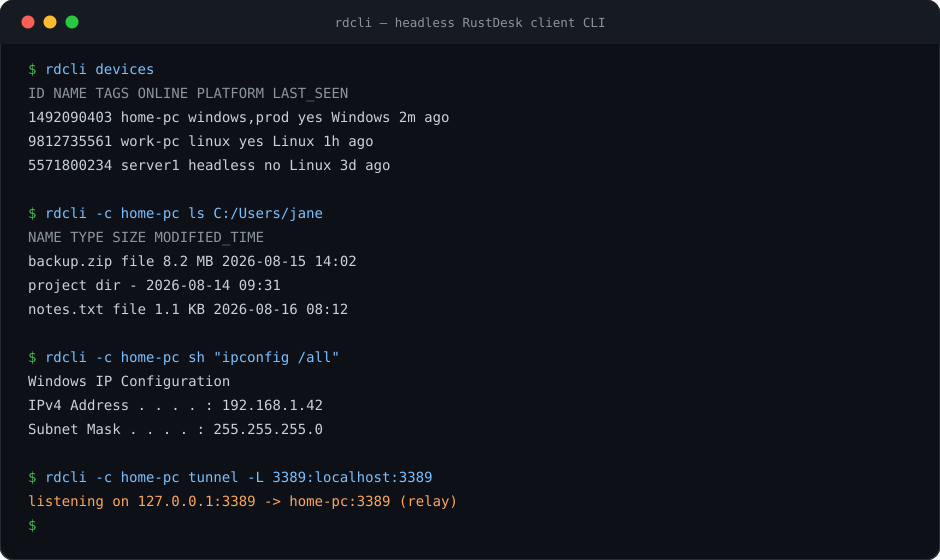

# rdcli — headless RustDesk client CLI

[](https://go.dev)
[](https://github.com/4nkitd/rustdesk-cli/releases)
[](LICENSE)
[](https://github.com/4nkitd/rustdesk-cli/actions)
[](https://github.com/4nkitd/rustdesk-cli)

A pure-Go CLI that speaks the RustDesk wire protocol directly — no GUI, no official binary required. Connect to any RustDesk machine by ID, name, or tag and do real work: remote file transfer, TCP tunnels, and remote shells. Output is designed for both humans and AI agents (stable aligned tables + strict JSON).



```
rdcli -c home-pc ls C:/Users/jane
rdcli -c home-pc cp ./backup.tar.gz C:/Users/jane/Desktop/
rdcli -c home-pc sh "ipconfig"
rdcli -c home-pc tunnel -L 3389:localhost:3389
```

## Why

RustDesk's public server now requires login, and the desktop GUI is the only official client. `rdcli` speaks the protocol itself: it reuses your existing RustDesk login (including the desktop app's remembered credentials), punches through NAT via hbbs, relays via hbbr, and authenticates to the controlled peer — all from a terminal.

## Use cases

- **Scripting & automation** — run remote commands, copy files, and set up tunnels from cron, CI, or deploy scripts; exit codes and JSON output make it pipe-friendly.
- **AI agents** — `--json` everywhere and no interactive prompts means a model can drive it: list devices, inspect a machine, pull logs.
- **Headless boxes** — manage machines that only have RustDesk installed (no display, no GUI session) straight from your terminal.
- **Homelab / self-hosted RustDesk** — point it at your own hbbs/hbbr with `--server`/`--key`, or use the Pro address-book API for device discovery.
- **RDP/SSH jump** — `tunnel -L` turns any RustDesk peer into a bastion: `rdcli -c home-pc tunnel -L 3389:localhost:3389` then `mstsc`.

## Install

### Homebrew (macOS / Linux)

```sh
brew tap 4nkitd/tap
brew trust 4nkitd/tap        # required on newer Homebrew for third-party taps
brew install rustdesk-cli
```

### Prebuilt binaries

Grab the right `rdcli-<os>-<arch>` asset from [Releases](https://github.com/4nkitd/rustdesk-cli/releases), then:

```sh
chmod +x rdcli-linux-amd64
sudo mv rdcli-linux-amd64 /usr/local/bin/rdcli
```

### From source

```sh
go install github.com/4nkitd/rustdesk-cli/cmd/rdcli@latest
```

## Quick start

```sh
# 1. Pull your machines + passwords from the desktop app (optional but handy)
rdcli import-gui

# 2. Check login status (the CLI can reuse your RustDesk GUI login)
rdcli auth status

# 3. Remember a machine's password (by id, name, or tag)
rdcli connect home-pc -p "your-password"

# 4. Go
rdcli -c home-pc ls C:/Users/jane
rdcli -c home-pc cp ./file.txt C:/Users/jane/Desktop/
rdcli -c home-pc cp C:/Users/jane/Desktop/file.txt ./
rdcli -c home-pc sh "whoami"
rdcli -c home-pc tunnel -L 8080:localhost:80
```

Machine refs resolve in this order: **exact ID → name (case-insensitive substring) → tag → raw ID**.

## Authentication

The public RustDesk server requires a login token. `rdcli` gets one from:

1. `--token` flag
2. `RDC_TOKEN` env var
3. `access_token` in your `config.toml`
4. **The desktop GUI's stored login** (auto-detected from your RustDesk install)

```sh
rdcli auth status        # show login state, token source, user info
rdcli auth import-gui    # persist the desktop app's token into rdcli config
rdcli auth set <token>   # set a token explicitly
rdcli auth logout        # clear the stored token
```

With a token present, `rdcli` performs the full hbbs `KeyExchange` handshake (signed server key + NaCl box session) and sends the token as `PunchHoleRequest.token` — the same flow as the official client.

Saved peer passwords work too: `rdcli` understands the desktop app's encrypted `00...` password blobs (decrypts them with the machine key like the GUI does) as well as plaintext passwords.

## Commands

### `rdcli ls <ref> [remote_path]`

List a remote directory (default: current dir).

```sh
rdcli -c home-pc ls
rdcli -c home-pc ls C:/Users/jane --json
```

### `rdcli cp <ref> <src> <dst> [-r]`

Copy files either direction. Direction is auto-detected: a destination starting with `/` or a drive letter (`C:`) is remote.

```sh
rdcli -c home-pc cp ./backup.zip C:/Users/jane/Desktop/          # upload
rdcli -c home-pc cp C:/Users/jane/Desktop/backup.zip ./          # download
rdcli -c home-pc cp -r ./project C:/Users/jane/project           # recursive
rdcli -c home-pc cp -d up ./f.txt C:/Users/jane/f.txt            # force direction: up|down
```

Progress bar goes to stderr (stdout stays clean for pipes and JSON).

### `rdcli sh <ref> [command]`

Interactive PTY without a command; one-shot execution with one.

```sh
rdcli -c home-pc sh
rdcli -c home-pc sh "ipconfig /all"
```

### `rdcli tunnel <ref> -L <lport>:<rhost>:<rport> [--once]`

TCP port forward through the peer.

```sh
rdcli -c home-pc tunnel -L 3389:localhost:3389      # RDP through the peer
rdcli -c home-pc tunnel --once -L 0:localhost:22    # single stream, pipes stdin/stdout
```

### `rdcli devices` / `rdcli tag`

Address book and local tags.

```sh
rdcli devices                     # table: ID NAME TAGS ONLINE PLATFORM LAST_SEEN
rdcli devices --online --tag prod
rdcli devices search home --json
rdcli tag add 1234567890 prod
rdcli tag rm 1234567890 prod
rdcli tag ls
```

### `rdcli connect` / `rdcli disconnect`

Save/forget peer passwords in config (supports id, name, or tag refs).

```sh
rdcli connect home-pc -p "your-password"
rdcli connect 1234567890          # prompts-free: uses RDC_PASSWORD / config only
rdcli disconnect home-pc
```

### `rdcli ping <ref>`

Online check via the rendezvous server (exit 0 = online, 1 = offline).

## Common flags

| Flag | Env | Description |
|---|---|---|
| `-c, --connect <ref>` | | Machine ref: id, name, or tag |
| `--password <pw>` | `RDC_PASSWORD` | Peer password |
| `--token <tok>` | `RDC_TOKEN` | Login token (falls back to config / GUI) |
| `--server <host:port>` | `RDC_SERVER` | Rendezvous server (default: rs-ny.rustdesk.com:21116) |
| `--key <key>` | `RDC_KEY` | Licence key for self-hosted servers |
| `--relay` | | Force relay, skip hole punching |
| `--yes` | | Accept insecure direct-IP connections |
| `--json` | | Machine-readable JSON output |
| `--timeout <duration>` | | Connect timeout (default 10s) |

## JSON output

All output is a single JSON object on stdout; errors go to stderr; no progress/colors pollute stdout.

```json
{"version":1,"devices":[{"id":"1234567890","name":"home-pc","tags":["windows"],"online":true,"platform":"Windows","last_seen":"","source":"local"}]}
```

```json
{"version":1,"path":"C:/Users/jane","entries":[{"name":"Desktop","type":"dir","size":0,"modified_time":1755317100,"is_hidden":false}]}
```

## Config

`~/.config/rdcli/config.toml` (override with `$RDC_CONFIG`):

```toml
server = ""               # empty = public rustdesk.com servers
key = ""                  # self-hosted licence key
access_token = ""         # public-server login token (see `rdcli auth`)

api_server = ""           # self-hosted Pro API base URL (address book)
api_username = ""
api_password = ""

[peers."1234567890"]
password = "00AAAAAAAAAAAAAAAAAAAAAAAAAAAAAAAAAAAAAAAAAAAAAAAAAAAAAAAAAAAAAAAAAAAAAAAAAAAAAAAAAA=="
name = "home-pc"

[tags]
"1234567890" = ["windows", "prod"]
```

`rdcli import-gui` populates peers from your desktop app automatically. The config file is written with `0600` permissions.

## Exit codes

| Code | Meaning |
|---|---|
| 0 | Success |
| 1 | Runtime / auth / network error |
| 2 | Usage error |

## Limitations

Honest list — read before you rely on it:

- **No screen sharing, clipboard sync, or audio.** This is a headless client for file/terminal/tunnel work, not a full remote-desktop replacement.
- **UDP NAT test is not implemented** — direct hole punching uses TCP only, so some symmetric-NAT peers fall back to relay. Relay always works.
- **Terminal requires peer ≥ 1.4.1** (older peers reject terminal sessions).
- **Public server needs a login token** — same as the official client since RustDesk enabled mandatory login.
- **Not affiliated with RustDesk.** An independent, clean-room-ish port of the wire protocol (see License).

## FAQ

**Is this an official RustDesk tool?**
No. It's an independent CLI that interoperates with the RustDesk ecosystem (public servers, self-hosted hbbs/hbbr, and the official desktop client).

**Can I use it with my self-hosted RustDesk server?**
Yes — pass `--server <host:port>` and `--key <licence-key>`, or set them in config. Self-hosted Pro address books work via `api_server`/`api_username`/`api_password`.

**Do I need the RustDesk GUI installed?**
No. The GUI is optional — `import-gui` is a convenience to reuse an existing login and saved passwords. Everything works standalone with `--token`/`RDC_TOKEN`.

**Is it safe to store passwords in config?**
The config file is written with `0600` permissions (owner-only). Peer passwords are stored the same way the desktop app does; encrypted `00...` blobs are decrypted only in memory for the handshake.

**Why AGPL-3.0?**
The wire protocol details were ported from the AGPL-licensed RustDesk sources, so rdcli is AGPL-3.0 too. That's the correct and honest license for this project.

## Protocol notes

- **Framing**: variable-length little-endian header (1–4 bytes), bottom 2 bits = header length, remaining bits = payload length (ported from `bytes_codec.rs`).
- **Crypto**: NaCl `box` for key exchange, `secretbox` for streams with sequential nonces; Ed25519 server-signed identity blobs (signature-first layout, like sodiumoxide `sign::sign`).
- **Rendezvous**: `PunchHoleRequest` over TCP (UDP NAT test not implemented — direct punch may be limited; relay always works), token-authenticated via hbbs `KeyExchange`.
- **Login**: password hashed `sha256(sha256(pw+salt)+challenge)`; supports the GUI's encrypted `00`-prefixed password blobs.

## Roadmap

- UDP NAT traversal for reliable direct connections
- Windows release binaries in CI (formula/build matrix already prepared)
- Clipboard and session-aware file resume improvements
- Shell completion scripts (bash/zsh/fish)

## Development

```sh
go build ./...
go test ./...
go vet ./...
```

Release builds for linux/darwin/windows (amd64+arm64) are automated via GitHub Actions on `v*` tags.

## License

AGPL-3.0 — this project ports wire-protocol details from the AGPL-licensed [RustDesk](https://github.com/rustdesk/rustdesk) sources.

---

Like it? [Star the repo](https://github.com/4nkitd/rustdesk-cli) and tell me what you'd use it for. Issues, PRs, and wild feature requests are welcome.
